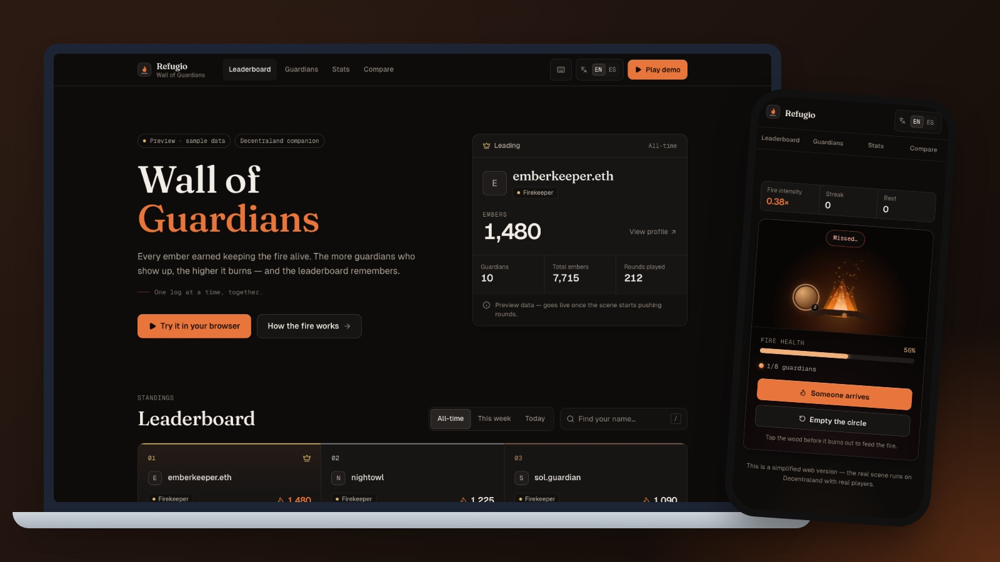
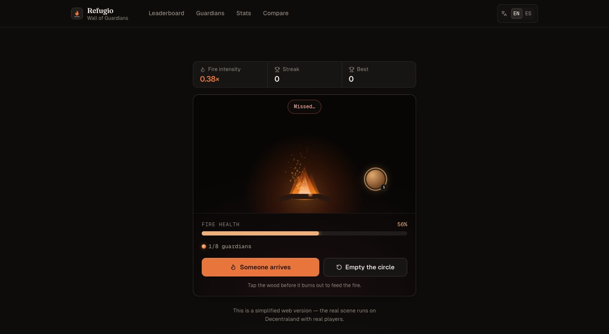
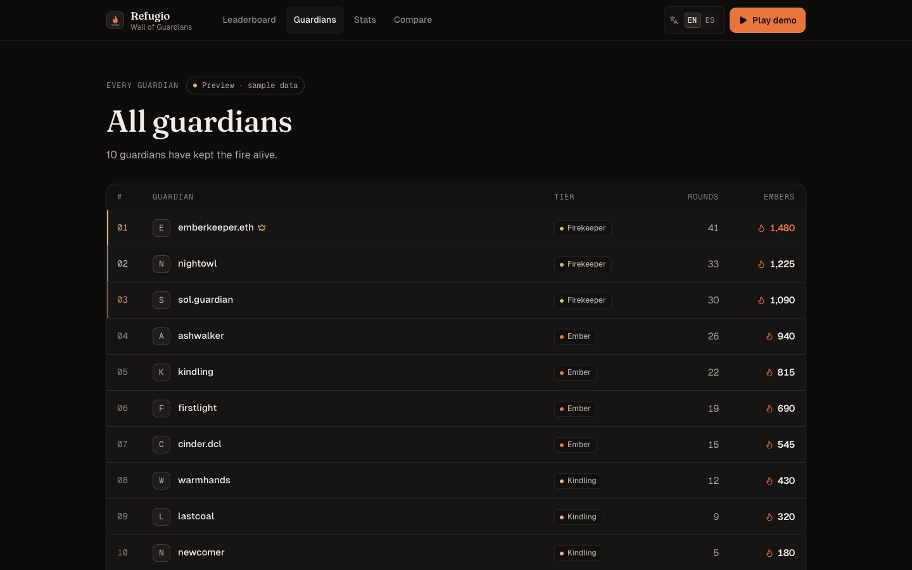
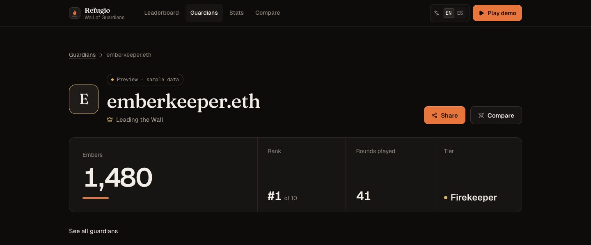
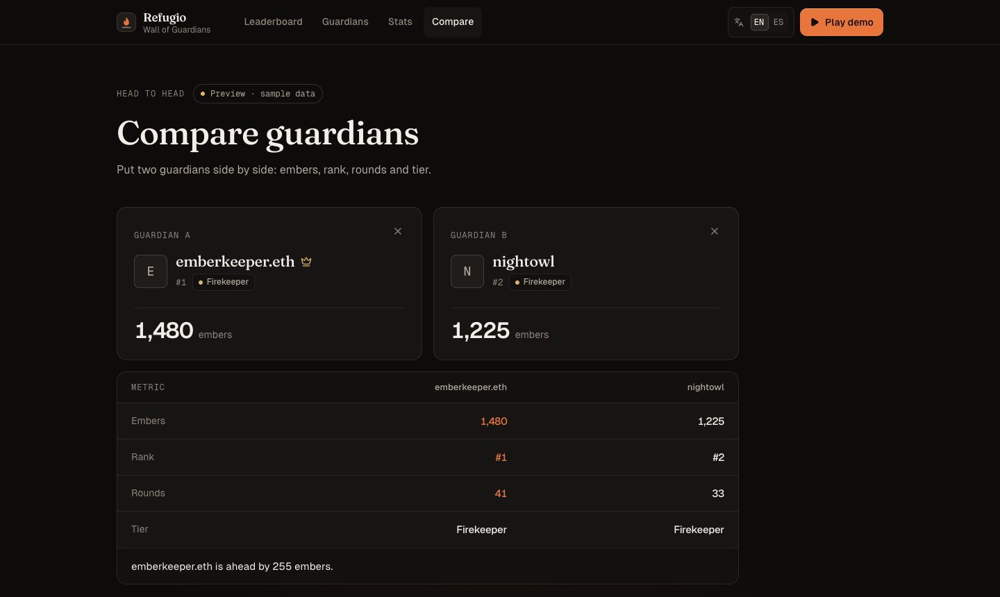
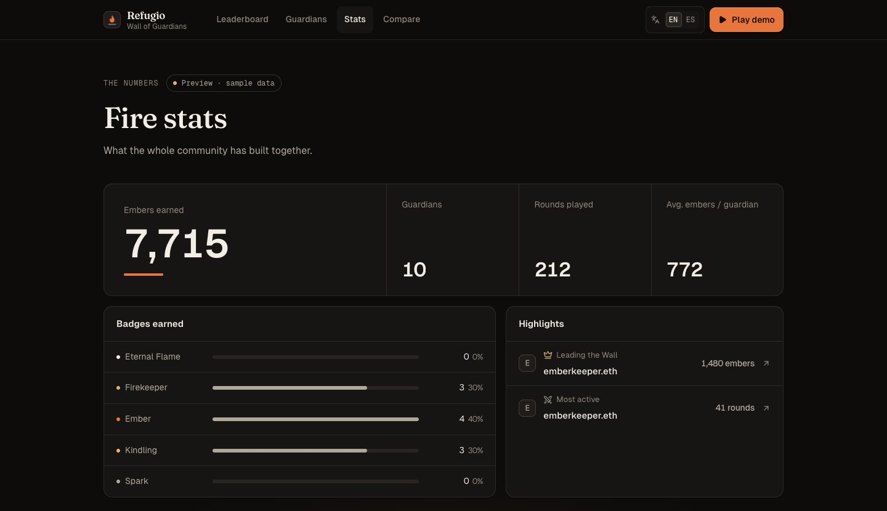
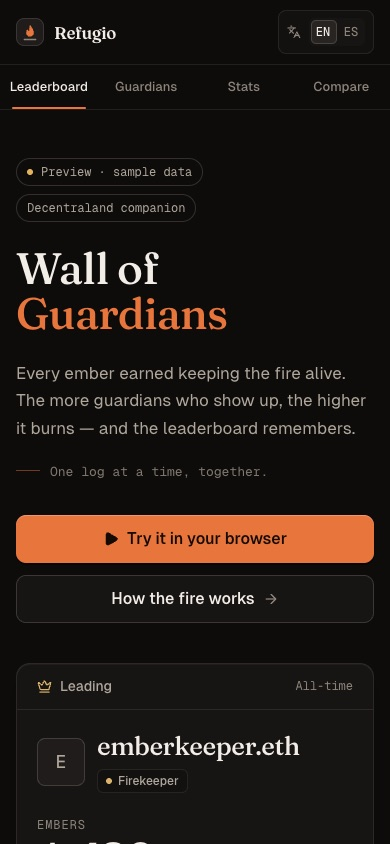
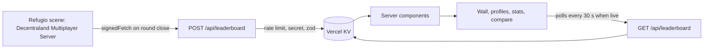

<div align="center">

# Wall of Guardians

### The public leaderboard for Refugio, a Decentraland campfire that only burns when people show up.

[](https://wall-of-guardians.vercel.app)
[](https://wall-of-guardians.vercel.app/demo)
[](https://github.com/ALFA117/Refugio)
[](LICENSE)


<br/>



**[▶ Open the Wall](https://wall-of-guardians.vercel.app)** · **[Play the demo](https://wall-of-guardians.vercel.app/demo)** · **[How it works](#-how-the-data-flows)** · **[Architecture notes](docs/ARCHITECTURE.md)**

</div>

> [!NOTE]
> Until the Refugio scene is published and pushing rounds, the live site serves **representative sample data** and says so on every page (*Preview · sample data*). The guardian names and numbers in these screenshots come from that sample set.

---

## 🎯 Why a website for a metaverse scene

[Refugio](https://github.com/ALFA117/Refugio) is a cooperative campfire in **Decentraland (SDK7)**: the more people sit around it, the higher it burns, and strangers keep it alive together in 3-minute rounds. The problem is that everything that happens in a metaverse scene stays *inside* the metaverse.

The Wall takes the ranking **outside**, to a normal web page you can open on any phone and share with a link. It also lets people who can't or won't install the Decentraland client **feel the mechanic in the browser** before visiting. That's the *Retention & Discovery* angle of the Friendzone hackathon.

## 🔥 What's inside

### The Wall (`/`)

- Live leaderboard with **All-time / This week / Today** filters, synced to the URL (`?tf=week` is itself shareable).
- Search with highlight (press `/`), milestone badges and a sticky "leading" bar once the podium scrolls away.
- Deep-linkable **guardian profiles** at `/guardians/[name]`, each with its own Open Graph share card, a Web Share button and rank/streak stats.
- `/guardians` (full roster), `/stats` (community numbers and badge distribution) and `/compare` (any two guardians, head to head).
- Bilingual (English by default, Spanish toggle), installable as a PWA, and a hidden easter egg (5 rapid taps on the language toggle).

### The demo (`/demo`)

A small, real game, not just a readout:

- **3 difficulty modes** that tune wood timing, decay and how much firewood can be alight at once.
- **8-seat guardian ring** around a layered campfire, matching the real scene's seat count.
- **Feed-the-fire loop:** tap the wood before it burns out; streak and best-streak tracking, spark bursts, a low-health warning and haptic feedback where supported.
- **Game over** screen with your best streak and a share button. Difficulty and best streak persist across visits.

<table>
<tr>
<td width="50%"><p align="center"><sub>The demo: tap the wood before it burns out.</sub></p></td>
<td width="50%"><p align="center"><sub>Every guardian, with tier, rounds and embers.</sub></p></td>
</tr>
<tr>
<td width="50%"><p align="center"><sub>Shareable guardian profile.</sub></p></td>
<td width="50%"><p align="center"><sub>Head to head in <code>/compare</code>.</sub></p></td>
</tr>
<tr>
<td width="50%"><p align="center"><sub>What the whole community has built.</sub></p></td>
<td width="50%" align="center"><p align="center"><sub>Made for phones first.</sub></p></td>
</tr>
</table>

## 🧠 How the data flows



When a round closes in the scene, the authoritative server `signedFetch`es a snapshot of the top guardians to `POST /api/leaderboard`. The route rate-limits by IP, checks a shared secret (`x-refugio-secret`), validates shape and bounds with zod, and stores a single JSON value in **Vercel KV** (Upstash Redis): no SQL, no schema. A daily snapshot is kept for trends. Pages read it server-side and the Wall polls every 30 s once the source is live.

More detail (data model, request flow, page structure) in **[docs/ARCHITECTURE.md](docs/ARCHITECTURE.md)**.

## 🛠️ Stack

| Layer | Technology |
|:--|:--|
| Web | Next.js 14 (App Router) · React 18 · TypeScript · Tailwind CSS · Framer Motion · lucide-react |
| Data | Vercel KV (Upstash Redis) · zod for ingest validation |
| Quality | Vitest (badge tiers, fuzzy name matching, i18n key parity, history, rate limit) · Playwright smoke tests with an axe-core accessibility pass on every page · GitHub Actions CI |
| Deploy | Vercel (with Analytics and Speed Insights) |

## 🚀 Run it locally

```bash
npm install
npm run dev
```

No environment variables are needed: without KV the site serves the sample data.

<details>
<summary><b>Tests</b></summary>

```bash
npm test          # Vitest: pure logic
npm run build     # required once before test:e2e (it starts the built app, not the dev server)
npm run test:e2e  # Playwright: smoke tests + axe-core a11y pass on every page
```

The E2E suite runs against a production build (`next start`) on port 3100, serially (one worker): a single Next.js server handling a dozen simultaneous first navigations from parallel browser contexts turned out to be the bottleneck, not anything worth testing for.

</details>

<details>
<summary><b>Go live with real data</b></summary>

1. In the Vercel dashboard: **Storage → Create Database → KV (Upstash for Redis)** and connect it to the project. Vercel adds `KV_REST_API_URL` / `KV_REST_API_TOKEN` automatically.
2. Add one env var yourself: `REFUGIO_INGEST_SECRET` (any long random string).
3. In the Refugio scene deploy, set `COMPANION_URL=https://<site>/api/leaderboard` and `COMPANION_SECRET` (same value as `REFUGIO_INGEST_SECRET`). The server pushes on every round close.

</details>

## 🏕️ Part of Refugio

| Repo | What it is |
|:--|:--|
| [ALFA117/Refugio](https://github.com/ALFA117/Refugio) | The Decentraland SDK7 scene: the campfire, the seats, the cooperative round and the server that awards embers |
| **ALFA117/refugio-wall** (this repo) | The public web companion: leaderboard, profiles, stats and the browser demo |

Built for the **Friendzone Hackathon** on DoraHacks.

## 📄 License

[MIT](LICENSE)

---

<div align="center">

**One log at a time, together.**

</div>
